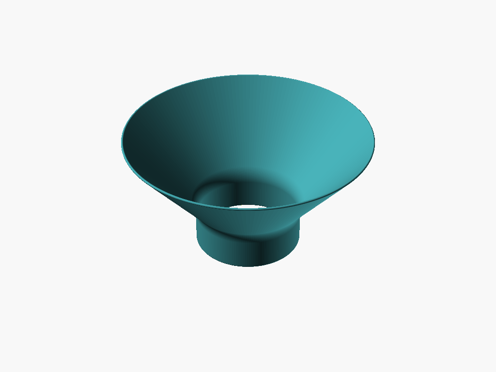
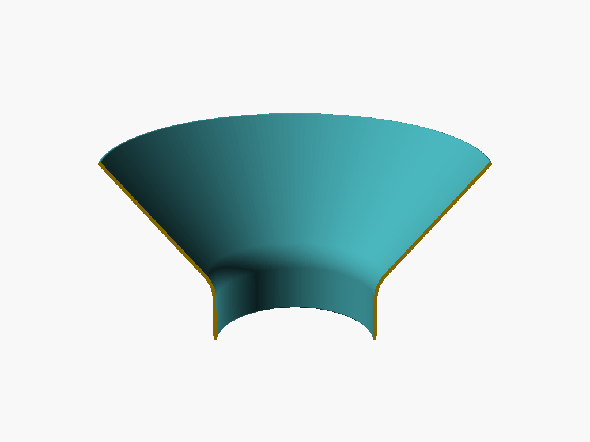

# Cat Feeder Funnel (PetLibro)

A wide funnel for pouring kibble into a PetLibro automatic feeder. The neck slides snugly into the 110 mm opening at the top of the food container and reaches 30 mm down, so the funnel stays put while you pour. The top is 250 mm across, the widest that fits on a Bambu Lab X1C bed with a small margin.

## Design

* **No supports.** It prints upright (neck on the bed, wide end up). The cone leans 40° from vertical, under the usual 45° overhang limit.
* **Rounded edges everywhere.** The wall is drawn as a line of circles along a centreline (the `stroke()` module), so the rim and neck edge come out half-round. The neck edge is shaved flat by 0.4 mm so it grips the bed.
* **Less jamming,** with smooth walls that are easy to clean:
  * Steep walls: at 40° from vertical (50° from horizontal), kibble keeps sliding instead of piling up.
  * A smooth 25 mm throat curve where the cone meets the neck, so there is no ledge for kibble to bridge across.
  * A straight neck that never narrows, so kibble isn't squeezed on the way out.

## Parameters

Open [`cat_feeder_funnel.scad`](cat_feeder_funnel.scad) and use the Customizer panel. The main ones:

| Parameter | Default | What it does |
| --- | --- | --- |
| `container_opening` | `110` | Diameter of the feeder's opening (mm). |
| `neck_clearance` | `0.6` | Gap between neck and opening across the diameter. Lower is snugger. |
| `neck_depth` | `30` | How far the neck goes into the container. |
| `top_diameter` | `250` | Width of the top. Capped by `bed_size`. |
| `wall_angle` | `40` | Lean from vertical. Lower is steeper and taller; 45 is the max for no supports. |
| `wall_thickness` | `2.4` | Wall thickness, which also sets edge roundness. |
| `throat_radius` | `25` | Roundness of the cone-to-neck curve. |

If the neck is too tight, raise `neck_clearance` by 0.2 and reprint, or print just the bottom 35 mm first as a fit test.

## Print settings (Bambu Lab X1C)

* **Material:** PLA or PETG. PETG is a bit tougher if it gets knocked around.
* **Orientation:** As exported, neck down. No supports.
* **Layer height:** 0.2 mm. Variable layer height helps the throat curve look smooth.
* **Walls:** 3 or more, so the 2.4 mm wall prints solid.
* **Skirt / brim:** Off. The top is 250 mm wide on a 256 mm bed, so there's no room for a skirt at the top and the neck is already sturdy at the bottom.
* About 125 mm tall and roughly 225 g of PLA with the defaults.
