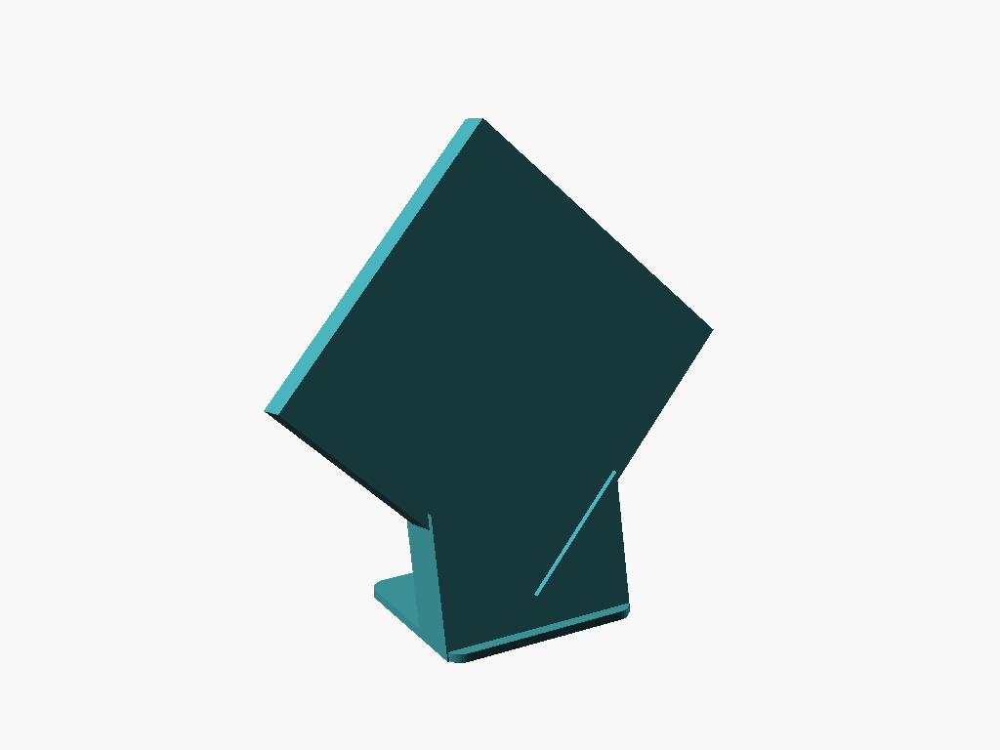
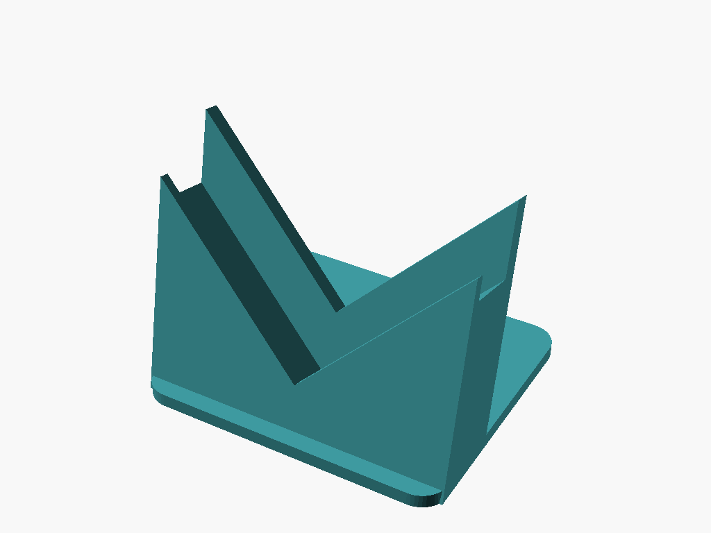
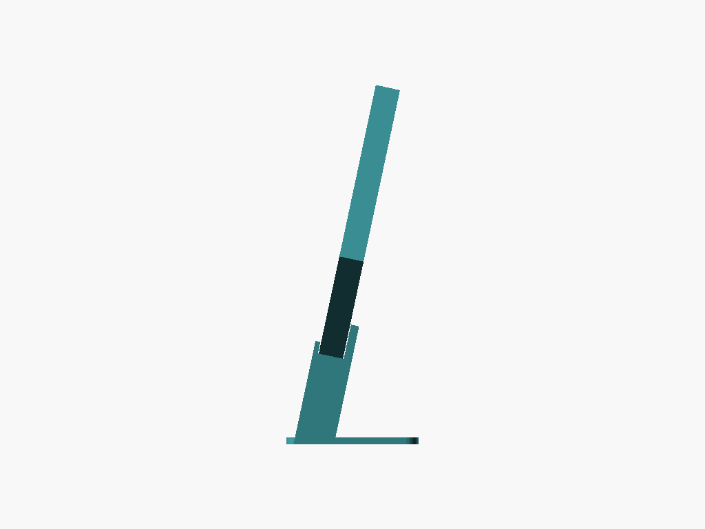

# Diamond Mosaic Stand

A desk stand that shows a 150 × 150 × 15 mm framed mosaic on one corner, as a diamond. The bottom corner drops into a V-shaped cradle that leans the mosaic back 12°, and a base plate reaches out behind so the leaning weight can't tip it over.

## Design

* **V cradle.** The seat is a 90° V that follows the mosaic's two bottom edges, so the corner centres itself. A small groove runs along the bottom of the V because a printed V can't be perfectly sharp, and the mosaic's corner would otherwise ride up on it.
* **Low front lip, taller back support.** The front lip is 5 mm tall (measured square to the edge), so it only covers the tips of the corner tiles. The back support is 15 mm tall, the full width of the wood border, so it supports the frame without pressing on the recessed back panel.
* **Tilt and stability.** The whole cradle is drawn upright, then rotated back by `tilt_angle`. The base reaches 70 mm behind the corner, well past the mosaic's centre of gravity (about 30 mm back at 12°). An `assert` stops the render if you shorten the base too far for the chosen tilt.
* **No supports.** Everything below the seat is solid down to the bed, so the only overhang is the back of the cradle leaning out by the tilt angle (12° from vertical).

## Parameters

Open [`mosaic_stand.scad`](mosaic_stand.scad) and use the Customizer panel. The main ones:

| Parameter | Default | What it does |
| --- | --- | --- |
| `mosaic_size` | `150` | Side length of the square mosaic. |
| `mosaic_thickness` | `15` | Thickness of the mosaic, tiles plus frame. |
| `frame_border` | `15` | Width of the wood border on the back. The back support must not be taller. |
| `tilt_angle` | `12` | Lean back from vertical, in degrees. |
| `arm_length` | `65` | Length of each cradle arm along the mosaic's edge. |
| `front_lip_height` | `5` | How much of the front face the lip covers. |
| `back_support_height` | `15` | Height of the back support on the wood border. |
| `base_depth_behind` | `70` | How far the base reaches behind the corner. |
| `slot_clearance` | `1.0` | Extra room in the slot. Lower it if the mosaic wobbles. |

## Print settings (Bambu Lab X1C)

* **Material:** PLA or PETG.
* **Orientation:** As exported, base down. No supports.
* **Layer height:** 0.2 mm.
* **Infill:** 15–20% is plenty; the cradle is a solid block.
* About 92 × 80 × 72 mm.
