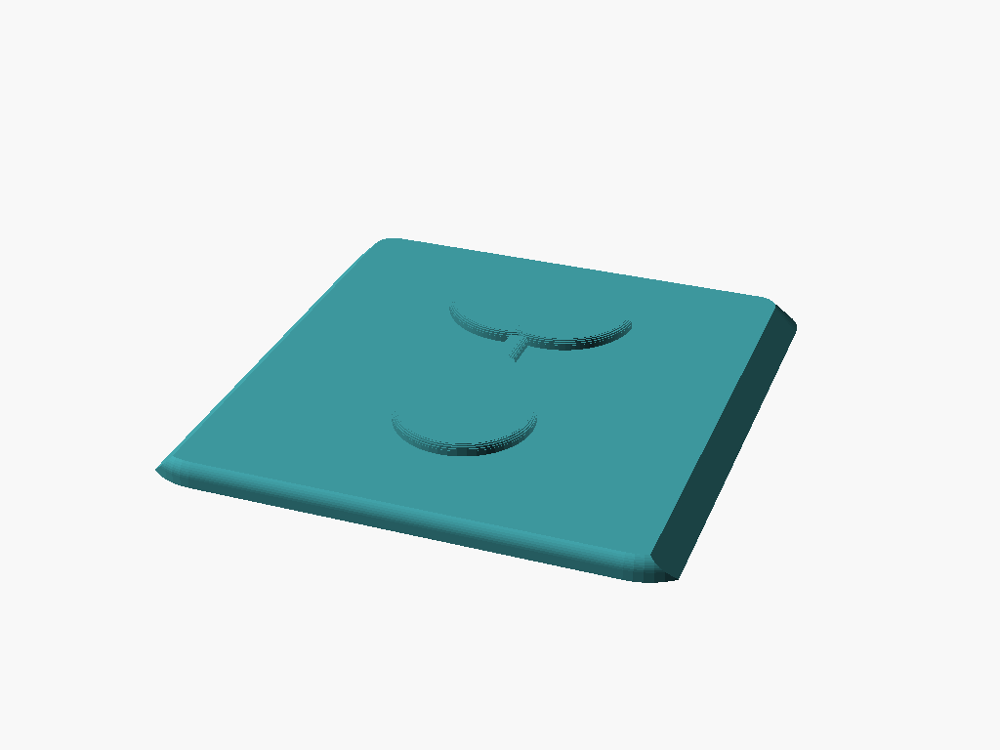

# Photosynthesis Seed Token Box

A tiny box for the seed tokens from the board game *Photosynthesis*. The inside is 28 × 28 × 15 mm, and a sliding lid with an embossed sprouting seed closes it.

## Design

* **Sliding dovetail lid.** The lid slides in from the front along grooves cut into the tops of the walls. The grooves lean in at 45°, so the walls hold the lid down. The lid only adds its own 1.6 mm thickness to the box: no hinge, no rim, nothing past the walls. The whole box is 32 × 32 × 17.8 mm, plus 0.6 mm for the seed.
* **Click shut.** A small dome on top of the front wall drops into a dimple under the lid when it's fully closed, so it doesn't slide open in the game box. Set `detent_height = 0` to turn it off.
* **Rounded everywhere.** The outside corners and edges are rounded, and the lid is cut from the same rounded shell so its front edge matches. Inside, the corners and floor are filleted, which costs nothing with round tokens and makes the last one easy to scoop out.
* **Embossed seed.** A teardrop seed with two leaves sprouting from it, raised 0.6 mm with a rounded top edge.

## Parameters

Open [`photosynthesis_seed_box.scad`](photosynthesis_seed_box.scad) and use the Customizer panel. The main ones:

| Parameter | Default | What it does |
| --- | --- | --- |
| `interior_width` / `interior_length` / `interior_height` | `28` / `28` / `15` | Inside size of the box. |
| `wall_thickness` | `2` | Side wall thickness. |
| `floor_thickness` | `1.2` | Floor thickness. |
| `lid_thickness` | `1.6` | Lid thickness. |
| `dovetail_depth` | `0.8` | How far the lid's groove cuts into each wall. |
| `slide_clearance` | `0.2` | Gap around the lid. Raise it if the lid binds, lower it if it rattles. |
| `detent_height` | `0.25` | Height of the click bump. `0` turns it off. |
| `seed_size` / `seed_height` | `18` / `0.6` | Size of the seed design and how far it stands up. |
| `assembled_lid_open` | `0` | How far the lid is slid open in the `assembled` view. |

## Print settings (Bambu Lab X1C)

* **Material:** PLA or PETG.
* **Orientation:** As exported. The box prints open side up and the lid prints seed side up, side by side. No supports: the only overhangs are the 45° dovetail lips.
* **Layer height:** 0.12–0.16 mm makes the seed and the dovetail smoother; 0.2 mm works.
* **Infill:** Doesn't matter much; the walls are nearly all perimeter.
* If the lid is stiff, raise `slide_clearance` by 0.05 and reprint just the lid with `part = "lid"`.
