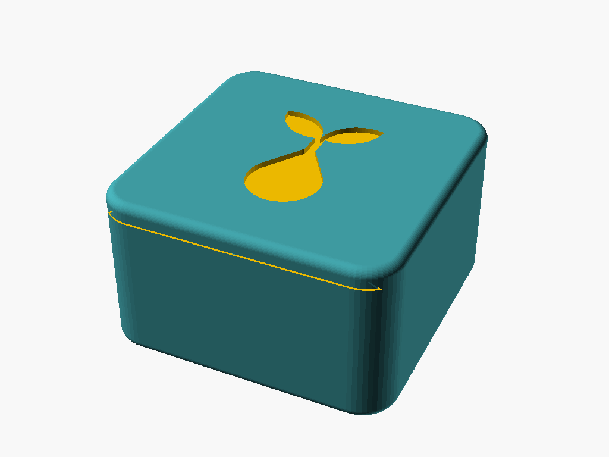
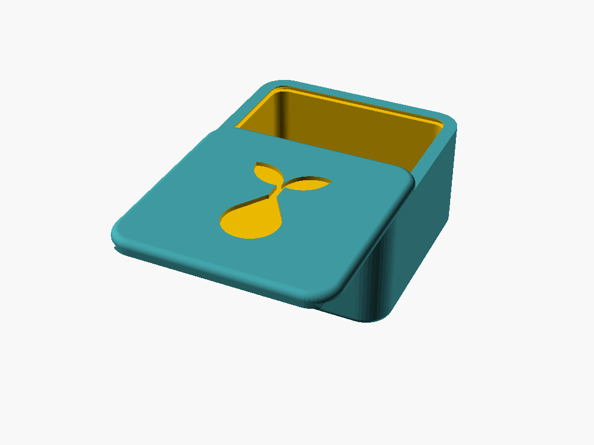
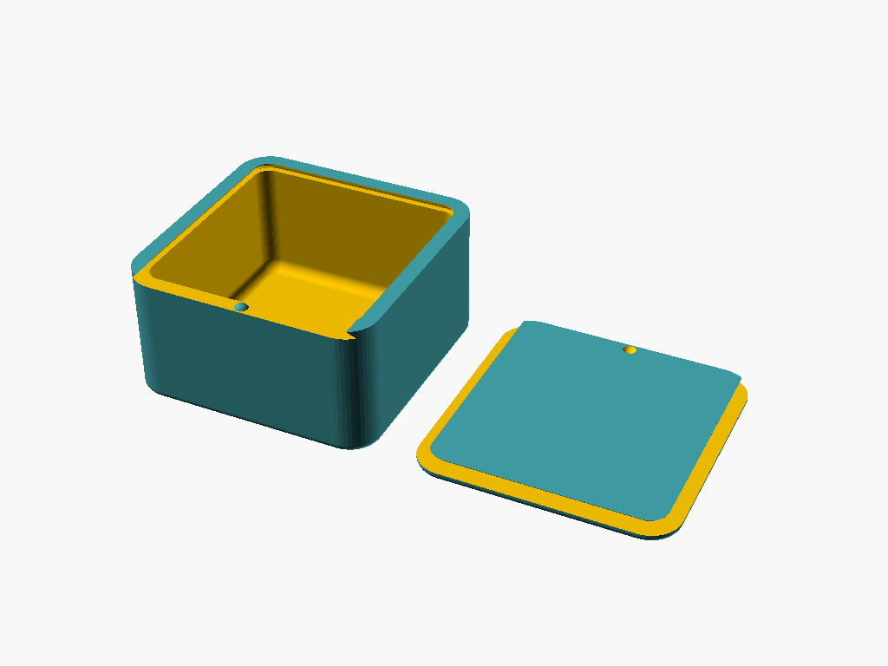

# Photosynthesis Seed Token Box

A tiny box for the seed tokens from the board game *Photosynthesis*. The inside is 28 × 28 × 15 mm, and a sliding lid with an engraved sprouting seed closes it.

## Design

* **Full-cover sliding lid.** The lid is a flat cap that covers the whole top, with a dovetail tongue underneath. The tongue slides along grooves in the walls that lean in at 45°, so the walls hold the lid down. Because the cap also covers the wall tops, the closed top is one smooth surface, and the only seam runs around the outside edge.
* **Clearances.** The tongue is `slide_clearance` (0.2 mm) smaller than its groove on every side, and it sits 0.2 mm above the groove floor. That way the cap resting on the wall tops is the only thing that sets the lid's height, which keeps the seam flush.
* **Space efficient.** The lid adds 2.2 mm to the height (a 1.2 mm cap plus a 1 mm tongue), with no hinge or rim. The whole box is 32 × 32 × 18.4 mm.
* **Click shut.** A small dome on the front wall drops into a dimple under the tongue when the lid is fully closed, so it doesn't slide open in the game box. Set `detent_height = 0` to turn it off.
* **Rounded everywhere.** The outside corners and edges are rounded, and the box and lid are cut from the same rounded shape so they line up. Inside, the corners and floor are filleted, which costs nothing with round tokens and makes the last one easy to scoop out.
* **Engraved seed.** A teardrop seed with two leaves sprouting from it, cut 0.6 mm into the cap.

## Parameters

Open [`photosynthesis_seed_box.scad`](photosynthesis_seed_box.scad) and use the Customizer panel. The main ones:

| Parameter | Default | What it does |
| --- | --- | --- |
| `interior_width` / `interior_length` / `interior_height` | `28` / `28` / `15` | Inside size of the box. |
| `wall_thickness` | `2` | Side wall thickness. |
| `floor_thickness` | `1.2` | Floor thickness. |
| `lid_cap_thickness` | `1.2` | Thickness of the cap that forms the top. |
| `lid_tongue_thickness` | `1` | Thickness of the dovetail tongue under the cap. |
| `dovetail_depth` | `0.8` | How far the lid's groove cuts into each wall. |
| `slide_clearance` | `0.2` | Gap around the lid. Raise it if the lid binds, lower it if it rattles. |
| `detent_height` | `0.25` | Height of the click bump. `0` turns it off. |
| `seed_size` / `seed_depth` | `18` / `0.6` | Size of the seed design and how deep it's cut. |
| `assembled_lid_open` | `0` | How far the lid is slid open in the `assembled` view. |

## Print settings (Bambu Lab X1C)

* **Material:** PLA or PETG.
* **Orientation:** As exported. The box prints open side up, and the lid prints upside down with the seed side on the bed. No supports: the only overhangs are 45° dovetail slopes. Printing the cap on the bed also gives the top a smooth, even finish.
* **Layer height:** 0.12–0.16 mm makes the dovetail smoother; 0.2 mm works.
* **Infill:** Doesn't matter much; the walls are nearly all perimeter.
* If the lid is stiff, raise `slide_clearance` by 0.05 and reprint just the lid with `part = "lid"`.
